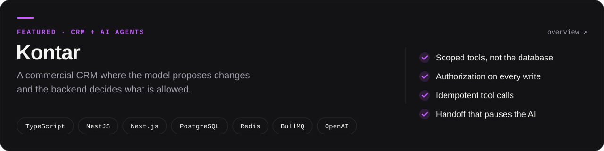
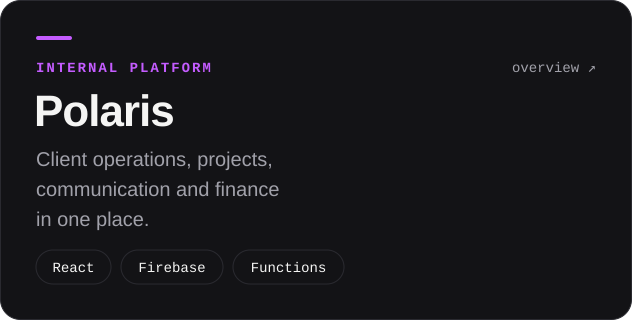
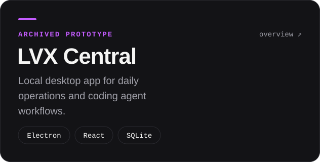
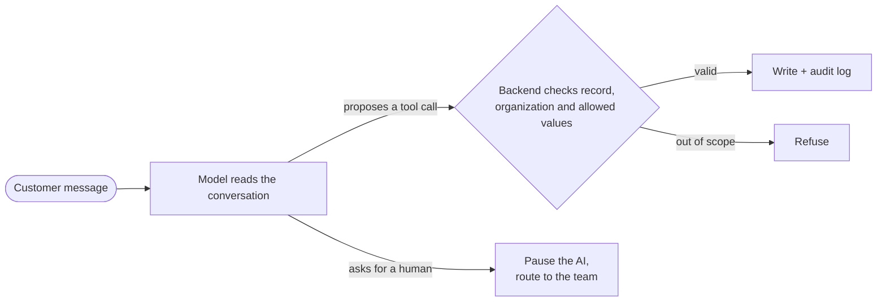

  <a href="https://www.linkedin.com/in/diogo-stein-ab83b122b/"><b>LinkedIn</b></a>
  &nbsp;·&nbsp;
  <a href="#how-i-put-an-llm-inside-a-product"><b>How I build</b></a>
  &nbsp;·&nbsp;
  <a href="#selected-work"><b>Selected work</b></a>

Hey, I'm Diogo, Head of Tech at **LVX Digital** in Brazil. I design business software and decide where a language model actually helps. The model reads the conversation and proposes; the software checks the rules and decides; a person steps in when it matters.

- 🛠️ Building **Kontar**, a CRM with AI agents that act through scoped tools
- 🧪 Writing a lesson on testing agent tools: rules in tests, model choices in evals
- 🤖 Shipping code with coding agents, one ticket per branch, reviewed before merge

## Selected work

&nbsp;

> 🔒 These are private systems. The overviews explain the engineering decisions; source code and client data stay private.

## How I put an LLM inside a product

1. **Scope the action.** The model gets a small set of named tools, never the database.
2. **Validate in the backend.** Every proposal is checked against the record, the organization and the allowed values before anything is written. Repeated calls don't repeat the effect.
3. **Hand off to a person.** A separate path pauses the AI and gives the conversation to the team.
4. **Verify the behavior.** Tests prove the rules. Evals measure the model's choices. I keep the two apart.

## Toolbox

**AI** &nbsp;`OpenAI API` `tool calling` `agents` `evals` `Claude Code` `Codex` 
**Backend** &nbsp;`TypeScript` `Node.js` `NestJS` `PostgreSQL` `Prisma` `Redis` `BullMQ` 
**Frontend** &nbsp;`React` `Next.js` `Vite` `Tailwind CSS` 
**Delivery** &nbsp;`Docker` `Linux` `GitHub` `Vercel` `Firebase`

Before tech, I worked in marketing and operations. That's why I start with the process and the people, and only then decide what to build.
